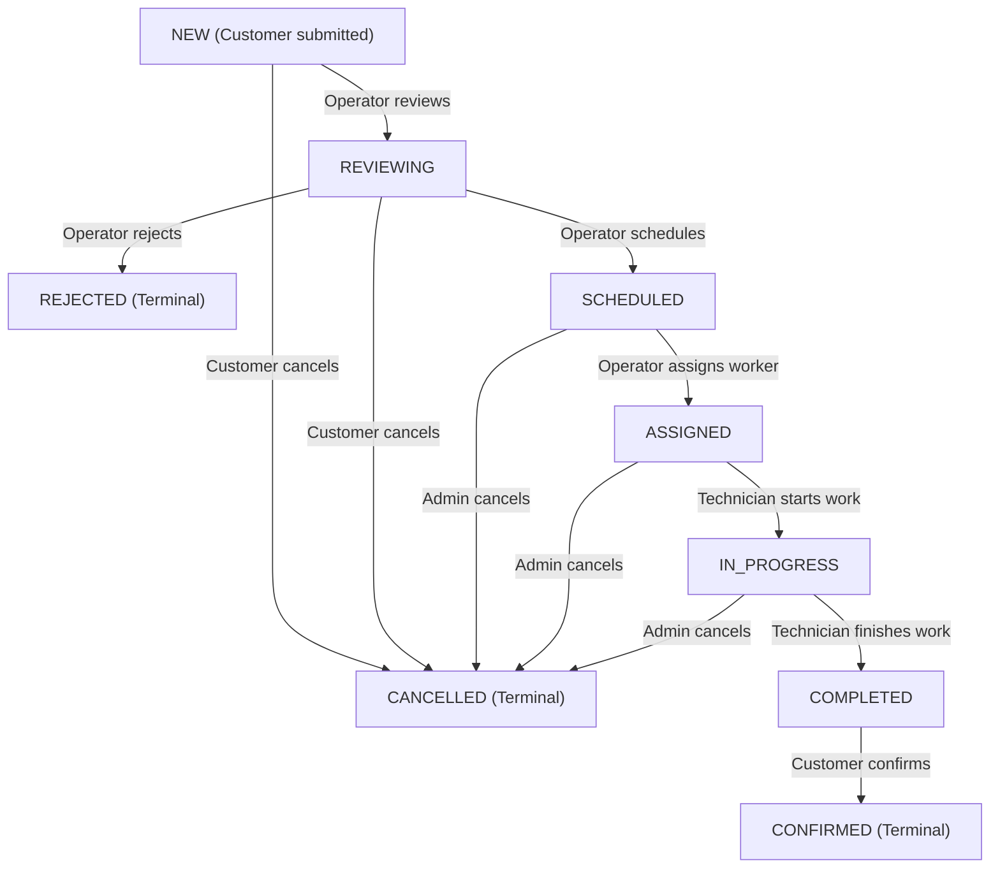

# TIKKA — Minimal Authorized Administrative Testing Workflow

**Module:** EC5208 — Mobile Application Development (Faculty of Engineering, University of Ruhuna)  
**Deliverable for:** Phase 10 (Issue #11) — Admin and Backend Testing Workflow  
**Milestone:** M3 — Feature Completion & Integration  
**Owner:** Member 2 — ashuraweismann (Herath H.M.K.U.A)  
**References:** [docs/SHARED_CONTRACTS.md](file:///e:/Projects/Mobile-app-dev-5th-sem/TIKKAapp/docs/SHARED_CONTRACTS.md), [docs/BACKEND_SPECIFICATION.md](file:///e:/Projects/Mobile-app-dev-5th-sem/TIKKAapp/docs/BACKEND_SPECIFICATION.md), [supabase/admin_workflow.sql](file:///e:/Projects/Mobile-app-dev-5th-sem/TIKKAapp/supabase/admin_workflow.sql), [supabase/seed_test_bookings.sql](file:///e:/Projects/Mobile-app-dev-5th-sem/TIKKAapp/supabase/seed_test_bookings.sql)

---

## 1. Executive Summary & Architectural Scope

In accordance with the project specification and boundaries:
* **No Administrative Mobile App:** The TIKKA customer client contains **zero admin portal screens** or privileged administrative UI.
* **Zero Privileged Secrets in Client:** The Flutter application bundles only the public anonymous key (`SUPABASE_ANON_KEY`) and URL. The privileged `service_role` key and database connection passwords are strictly excluded from git and client binaries.
* **Authorized Administrative Channel:** Administrative operations for managing service catalogs, viewing submitted bookings, advancing booking statuses, and assigning service technicians are performed via the **Supabase Dashboard (Studio)**, the **Supabase SQL Editor**, or automated administrative scripts using the `service_role` security boundary.

---

## 2. Defined Administrative Operations for MVP

| Administrative Operation | Description | Authorized Mechanism |
|---|---|---|
| **View All Bookings** | Query submitted bookings across all customers with contact details, scheduled times, and assigned workers. | Supabase Dashboard Table Editor (`public.bookings`) or `SELECT * FROM public.admin_list_bookings();` |
| **Status Progression** | Advance booking lifecycle through valid state machine transitions: `NEW` $\rightarrow$ `REVIEWING` $\rightarrow$ `SCHEDULED` $\rightarrow$ `ASSIGNED` $\rightarrow$ `IN_PROGRESS` $\rightarrow$ `COMPLETED`. | Supabase Table Editor or `SELECT public.admin_update_booking_status(...);` |
| **Worker Assignment** | Assign a designated technician/artisan (`assigned_worker_name`) to an approved booking. | Included in status advancement to `ASSIGNED`. |
| **Appointment Scheduling** | Record confirmed appointment date and time (`scheduled_at`). | Included in status advancement to `SCHEDULED`. |
| **Rejection Handling** | Reject an unserviceable request with an operator rejection note (`rejection_reason`). | `public.admin_update_booking_status('TK-xxxx', 'REJECTED', p_rejection_reason => '...');` |
| **Catalog Management** | Soft-delete/reactivate services (`is_active = FALSE/TRUE`) or adjust indicative base rates. | `SELECT public.admin_toggle_service_active('plumbing-general', FALSE);` or Table Editor. |

---

## 3. Booking Lifecycle State Machine & Transition Rules



### Transition Validation Rules
The database and repository strictly enforce that:
1. **Direct jumping across stages** (e.g., `NEW` $\rightarrow$ `COMPLETED`) is prohibited.
2. **Terminal states** (`CANCELLED`, `REJECTED`, `CONFIRMED`) can never be transitioned to any other state.
3. **Customer cancellations** are restricted strictly to `NEW` and `REVIEWING` states. Once scheduled or assigned, cancellation requires administrative intervention.
4. **Customer completion confirmation** is only permitted when the booking is in `COMPLETED` state.

---

## 4. Row Level Security (RLS) & Access Control Verification

All tables enforce Row Level Security at the PostgreSQL engine boundary:

| Table | Operation | Customer (`authenticated`) | Administrator (`service_role` / Studio) |
|---|---|---|---|
| `public.profiles` | `SELECT` / `UPDATE` | `auth.uid() = id` (Own profile only) | Full read/write access |
| `public.service_categories` | `SELECT` | `is_active = TRUE` only | Full read/write access |
| `public.services` | `SELECT` | `is_active = TRUE` only | Full read/write access |
| `public.services` | `INSERT` / `UPDATE` | **Blocked by RLS** (no policy exists) | Full read/write access |
| `public.bookings` | `INSERT` | Own customer ID, status must be `NEW` | Full read/write access |
| `public.bookings` | `SELECT` | `auth.uid() = customer_id` (Own bookings only) | Full read/write access |
| `public.bookings` | `UPDATE` (Cancel) | Only own bookings in `NEW` or `REVIEWING` | Full read/write access |
| `public.bookings` | `UPDATE` (Confirm)| Only own bookings in `COMPLETED` | Full read/write access |
| `public.bookings` | `UPDATE` (Admin)  | **Blocked by RLS** (`ASSIGNED`, `COMPLETED` cannot be set by customer) | Full read/write access |
| `public.reviews` | `INSERT` | Only own completed/confirmed bookings | Full read/write access |

---

## 5. Representative Test Bookings Catalog

The SQL script [supabase/seed_test_bookings.sql](file:///e:/Projects/Mobile-app-dev-5th-sem/TIKKAapp/supabase/seed_test_bookings.sql) seeds realistic test data covering every lifecycle state:

| Reference | Status | Category / Service | Customer / Location | Technician / Notes |
|---|---|---|---|---|
| **TK-1001** | `NEW` | Plumbing | Kasun Herath (Matara) | Leaking tap under sink; awaiting operator review. |
| **TK-1002** | `REVIEWING` | Electrical | Sunil Shantha (Galle) | Ceiling fan speed regulator humming; operator clarifying regulator model. |
| **TK-1003** | `SCHEDULED` | Cleaning | Anula Kumari (Kurunegala) | Full house deep cleaning; scheduled for tomorrow 09:00 AM. |
| **TK-1004** | `ASSIGNED` | Drainage & Unclogging | Prof. Jayawardena (Matara) | Blocked drain; assigned to **Kamal Perera** (Senior Plumber). |
| **TK-1005** | `IN_PROGRESS` | Handyman | Malith Silva (Galle) | Jammed door lock repair; **Nimal Bandara** currently on site. |
| **TK-1006** | `COMPLETED` | Painting | Nilmini Fernando (Badulla) | Living room wall painting finished; **eligible for customer review**. |
| **TK-1007** | `CONFIRMED` | Electrical | Saman Wickramasinghe (Tangalle) | Circuit breaker fixed by **Rohan De Silva**; **5-star review submitted**. |
| **TK-1008** | `CANCELLED` | Plumbing | Dhammika Perera (Matara) | Customer fixed leak with valve; cancelled before dispatch. |
| **TK-1009** | `REJECTED` | Repairs | Chaminda Dias (Hambantota) | Heavy industrial generator overhaul requested; rejected as out of residential scope. |

---

## 6. How to Perform Administrative Testing

### Method A: Via Supabase Studio Dashboard (Recommended for Demonstrations)
1. Log in to the [Supabase Dashboard](https://supabase.com/dashboard) and open the project.
2. Select **Table Editor** from the left navigation pane and click on `public.bookings`.
3. Locate the target booking reference (e.g., `TK-1001`).
4. Double-click the `status` column and change it to the target state (e.g., `ASSIGNED`).
5. Double-click `assigned_worker_name` and enter the technician's name (e.g., `Kamal Perera`).
6. In the customer mobile app, open the **Requests** tab and tap the booking: the tracking timeline immediately updates to reflect the new state.

### Method B: Via Supabase SQL Editor (`supabase/admin_workflow.sql`)
1. Open **SQL Editor** in the Supabase Dashboard.
2. Ensure [supabase/admin_workflow.sql](file:///e:/Projects/Mobile-app-dev-5th-sem/TIKKAapp/supabase/admin_workflow.sql) has been run once to register helper procedures.
3. Advance a booking using the validated procedure:
   ```sql
   -- 1. Advance to SCHEDULED with appointment time
   SELECT public.admin_update_booking_status(
       p_booking_reference => 'TK-1001',
       p_new_status => 'SCHEDULED',
       p_scheduled_at => NOW() + INTERVAL '1 day'
   );

   -- 2. Assign technician
   SELECT public.admin_update_booking_status(
       p_booking_reference => 'TK-1001',
       p_new_status => 'ASSIGNED',
       p_worker_name => 'Sunil Perera (Senior Plumber)'
   );

   -- 3. Move to IN_PROGRESS
   SELECT public.admin_update_booking_status(
       p_booking_reference => 'TK-1001',
       p_new_status => 'IN_PROGRESS'
   );

   -- 4. Mark COMPLETED
   SELECT public.admin_update_booking_status(
       p_booking_reference => 'TK-1001',
       p_new_status => 'COMPLETED'
   );
   ```

### Method C: Automated In-App Testing / Offline Demonstration
For automated integration testing or offline examiner evaluations, `SupabaseBookingsRepository` provides:
```dart
await repository.adminAdvanceStatus(
  bookingId: booking.id,
  targetStatus: 'COMPLETED',
  workerName: 'Kamal Perera',
);
```
This performs client-side state machine validation and updates the in-memory store identically to the database procedure.

---

## 7. Repeatable Demonstration Workflow (Grading Script)

To present a complete live demonstration of the end-to-end lifecycle to university examiners:

1. **Step 1 — Customer Booking Submission:**
   * Open the mobile application, navigate to **Services** $\rightarrow$ **Plumbing**.
   * Tap **Request Service** and complete the 2-step booking form.
   * Tap **Confirm Request**. A new booking reference (e.g., `TK-1043`) is generated in status `NEW`.
2. **Step 2 — Customer Request Tracking:**
   * In the app, navigate to **Requests** $\rightarrow$ **Active** tab.
   * Tap the newly created request. The tracking timeline displays `NEW` active, with no worker assigned.
3. **Step 3 — Administrative Progression (Supabase Studio / SQL):**
   * In Supabase Studio, run:
     ```sql
     SELECT public.admin_update_booking_status('TK-1043', 'REVIEWING');
     SELECT public.admin_update_booking_status('TK-1043', 'SCHEDULED', p_scheduled_at => NOW() + INTERVAL '1 day');
     SELECT public.admin_update_booking_status('TK-1043', 'ASSIGNED', p_worker_name => 'Kamal Perera');
     ```
4. **Step 4 — Real-Time Customer Tracking Verification:**
   * In the mobile app on the **Request Tracking** screen, pull-to-refresh or tap the refresh icon.
   * The progress timeline advances to **ASSIGNED**, and "Assigned worker: Kamal Perera" is displayed.
5. **Step 5 — Service Completion:**
   * In Supabase Studio, run:
     ```sql
     SELECT public.admin_update_booking_status('TK-1043', 'IN_PROGRESS');
     SELECT public.admin_update_booking_status('TK-1043', 'COMPLETED');
     ```
6. **Step 6 — Review Submission:**
   * Refresh the mobile app tracking screen: the status displays **COMPLETED** and the **Review service** button appears.
   * Tap **Review service**, select a star rating (e.g. 5 stars), enter a comment, and submit.
   * The review is persisted and tied to the booking.

---

## 8. Test Execution Evidence

All test suites verify administrative and backend security compliance:
```text
$ flutter test test/features/admin/backend_security_and_lifecycle_test.dart
00:00 +0: Phase 10 — Administrative & Backend Security Testing 1. Valid Booking Lifecycle State Machine Transitions
00:00 +1: Phase 10 — Administrative & Backend Security Testing 2. Rejection of Invalid State Transitions
00:00 +2: Phase 10 — Administrative & Backend Security Testing 3. Customer Permission Boundaries (Cancellation & Status Mutation)
00:00 +3: Phase 10 — Administrative & Backend Security Testing 4. Review Eligibility Matrix
00:00 +4: Phase 10 — Administrative & Backend Security Testing 5. Booking Tracking Screen reflects status change and worker assignment
00:00 +5: Phase 10 — Administrative & Backend Security Testing 6. Zero Privileged Secrets in Flutter Codebase Verification
00:00 +6: All tests passed!
```
Historical Phase 10 execution covered **52 / 52 tests**. The Phase 12 final
execution covered **56 / 56 tests passed**, with **0 static analysis issues**;
see [docs/qa/test-execution-report.md](qa/test-execution-report.md).
