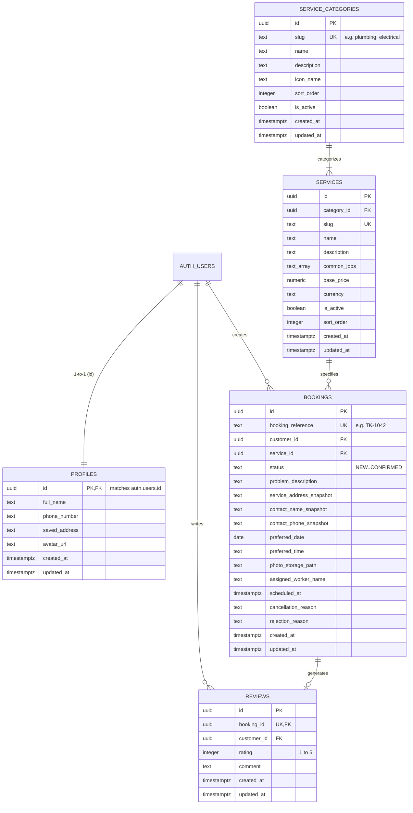
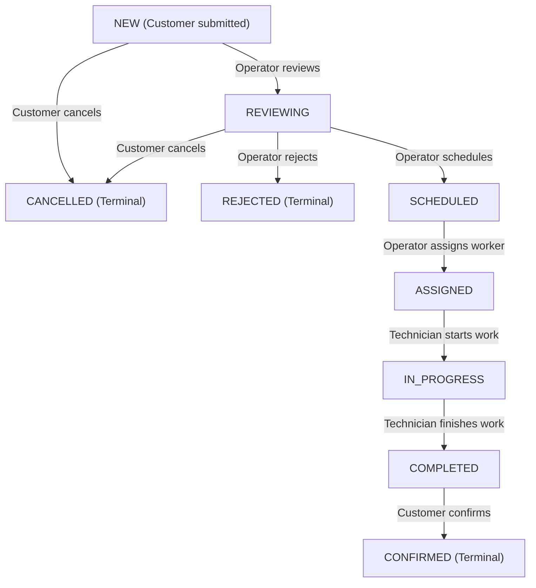

# TIKKA Backend Specification & Schema Documentation

**Module:** EC5208 — Mobile Application Development (Faculty of Engineering, University of Ruhuna)  
**Deliverable for:** Phase 02 (Issue #3) — Supabase Backend, Database Schema and Security  
**Owner:** Member 2 — ashuraweismann (Herath H.M.K.U.A)  
**References:** [docs/SHARED_CONTRACTS.md](file:///e:/Projects/Mobile-app-dev-5th-sem/TIKKAapp/docs/SHARED_CONTRACTS.md), [docs/ARCHITECTURE.md](file:///e:/Projects/Mobile-app-dev-5th-sem/TIKKAapp/docs/ARCHITECTURE.md), [docs/DESIGN_REFERENCE.md](file:///e:/Projects/Mobile-app-dev-5th-sem/TIKKAapp/docs/DESIGN_REFERENCE.md)

---

## 1. Overview & Architectural Role

The TIKKA backend uses **Supabase** (managed PostgreSQL with built-in Auth, Storage, and Row Level Security).
Per the academic requirements and project boundaries:
* The Flutter client app uses only the client-safe `SUPABASE_URL` and `SUPABASE_ANON_KEY`.
* **Zero privileged secrets** (service-role keys, database passwords) are stored in client code or Git.
* Authorization is enforced strictly at the database boundary through PostgreSQL Row Level Security (RLS).
* Customer identity is tied directly to the Supabase Auth UUID (`auth.uid()`).
* An automated administrative testing workflow is maintained outside the customer mobile application.

---

## 2. Entity-Relationship Diagram (ERD)



---

## 3. Database Tables & Fields

### 3.1 `public.profiles`
| Column | Type | Constraints | Description |
|---|---|---|---|
| `id` | `UUID` | `PRIMARY KEY REFERENCES auth.users(id) ON DELETE CASCADE` | Customer identity (matches Supabase Auth user) |
| `full_name` | `TEXT` | `NOT NULL` | Full name copied from user metadata on signup |
| `phone_number` | `TEXT` | `NULLABLE` | Contact phone number |
| `saved_address` | `TEXT` | `NULLABLE` | Default customer address (initially null) |
| `avatar_url` | `TEXT` | `NULLABLE` | Optional profile image |
| `created_at` | `TIMESTAMPTZ` | `DEFAULT now() NOT NULL` | Creation timestamp |
| `updated_at` | `TIMESTAMPTZ` | `DEFAULT now() NOT NULL` | Auto-updated timestamp |

### 3.2 `public.service_categories`
| Column | Type | Constraints | Description |
|---|---|---|---|
| `id` | `UUID` | `PRIMARY KEY DEFAULT gen_random_uuid()` | Category unique ID |
| `slug` | `TEXT` | `UNIQUE NOT NULL` | URL-safe identifier (e.g., `plumbing`) |
| `name` | `TEXT` | `NOT NULL` | Display name (e.g., `Plumbing`) |
| `description` | `TEXT` | `NULLABLE` | Short summary |
| `icon_name` | `TEXT` | `NULLABLE` | Material/Cupertino icon identifier |
| `sort_order` | `INTEGER` | `DEFAULT 0 NOT NULL` | Display sequence |
| `is_active` | `BOOLEAN` | `DEFAULT true NOT NULL` | Soft-delete / visibility flag |

### 3.3 `public.services`
| Column | Type | Constraints | Description |
|---|---|---|---|
| `id` | `UUID` | `PRIMARY KEY DEFAULT gen_random_uuid()` | Service unique ID |
| `category_id` | `UUID` | `REFERENCES public.service_categories(id) RESTRICT` | Parent category |
| `slug` | `TEXT` | `UNIQUE NOT NULL` | Unique slug |
| `name` | `TEXT` | `NOT NULL` | Service name |
| `description` | `TEXT` | `NOT NULL` | Service detail description |
| `common_jobs` | `TEXT[]` | `DEFAULT '{}' NOT NULL` | List of typical jobs (as in Figma) |
| `base_price` | `NUMERIC(10,2)`| `NULLABLE` | Indicative base rate (cash on completion) |
| `currency` | `TEXT` | `DEFAULT 'LKR' NOT NULL` | Currency code |
| `is_active` | `BOOLEAN` | `DEFAULT true NOT NULL` | Availability flag |
| `sort_order` | `INTEGER` | `DEFAULT 0 NOT NULL` | Sorting index |

### 3.4 `public.bookings`
| Column | Type | Constraints | Description |
|---|---|---|---|
| `id` | `UUID` | `PRIMARY KEY DEFAULT gen_random_uuid()` | Internal unique ID |
| `booking_reference` | `TEXT` | `UNIQUE NOT NULL` | Human-friendly reference (`TK-1001`...) |
| `customer_id` | `UUID` | `REFERENCES auth.users(id) ON DELETE CASCADE` | Owning customer |
| `service_id` | `UUID` | `REFERENCES public.services(id) ON DELETE RESTRICT` | Booked service |
| `status` | `TEXT` | `CHECK (status IN ('NEW','REVIEWING','SCHEDULED','ASSIGNED','IN_PROGRESS','COMPLETED','CONFIRMED','CANCELLED','REJECTED'))` | Current lifecycle state |
| `problem_description` | `TEXT` | `NOT NULL` | Customer problem description |
| `service_address_snapshot` | `TEXT` | `NOT NULL` | Immutable address for this booking |
| `contact_name_snapshot` | `TEXT` | `NOT NULL` | Contact name at booking creation |
| `contact_phone_snapshot` | `TEXT` | `NOT NULL` | Contact phone at booking creation |
| `preferred_date` | `DATE` | `NOT NULL` | Requested date |
| `preferred_time` | `TEXT` | `NOT NULL` | Preferred time slot |
| `photo_storage_path` | `TEXT` | `NULLABLE` | Relative path in `booking-photos` bucket |
| `assigned_worker_name` | `TEXT` | `NULLABLE` | Assigned technician name |
| `scheduled_at` | `TIMESTAMPTZ` | `NULLABLE` | Confirmed appointment time |
| `cancellation_reason` | `TEXT` | `NULLABLE` | Reason if cancelled |
| `rejection_reason` | `TEXT` | `NULLABLE` | Reason if rejected by operator |
| `admin_notes` | `TEXT` | `NULLABLE` | Internal administrative note |

### 3.5 `public.reviews`
| Column | Type | Constraints | Description |
|---|---|---|---|
| `id` | `UUID` | `PRIMARY KEY DEFAULT gen_random_uuid()` | Review ID |
| `booking_id` | `UUID` | `UNIQUE REFERENCES public.bookings(id) ON DELETE CASCADE` | 1 review per booking |
| `customer_id` | `UUID` | `REFERENCES auth.users(id) ON DELETE CASCADE` | Customer reviewer |
| `rating` | `INTEGER` | `CHECK (rating >= 1 AND rating <= 5)` | 1 to 5 star rating |
| `comment` | `TEXT` | `NULLABLE` | Customer written feedback |

---

## 4. Automated Triggers & Functions

1. **`handle_new_user()`**:
   * Attached to `AFTER INSERT ON auth.users`.
   * Automatically extracts `full_name` and `phone_number` from `raw_user_meta_data` and creates the corresponding row in `public.profiles`.
   * Executed with `SECURITY DEFINER` and hardened `search_path = public`.
2. **`generate_booking_reference()`**:
   * Attached to `BEFORE INSERT ON public.bookings`.
   * Assigns incremental sequence-based references prefixed with `TK-` (e.g. `TK-1001`, `TK-1002`, matching the Figma prototype's `#TK-1042`).
3. **`handle_updated_at()`**:
   * Attached to `BEFORE UPDATE` on `profiles`, `service_categories`, `services`, `bookings`, and `reviews`.
   * Automatically sets `updated_at = NOW()`.

---

## 5. Row Level Security (RLS) Matrix

| Table | Operation | Role | Policy / Restriction |
|---|---|---|---|
| **profiles** | `SELECT` | `authenticated` | `auth.uid() = id` (view own profile only) |
| **profiles** | `UPDATE` | `authenticated` | `auth.uid() = id` (edit own profile only) |
| **profiles** | `INSERT` | `authenticated` | `auth.uid() = id` |
| **service_categories** | `SELECT` | `authenticated`, `anon` | `is_active = TRUE` |
| **services** | `SELECT` | `authenticated`, `anon` | `is_active = TRUE` |
| **bookings** | `SELECT` | `authenticated` | `auth.uid() = customer_id` (view own bookings) |
| **bookings** | `INSERT` | `authenticated` | `auth.uid() = customer_id AND status = 'NEW'` |
| **bookings** | `UPDATE (cancel)` | `authenticated` | `auth.uid() = customer_id AND status IN ('NEW', 'REVIEWING')` $\rightarrow$ sets `'CANCELLED'` |
| **bookings** | `UPDATE (confirm)` | `authenticated` | `auth.uid() = customer_id AND status = 'COMPLETED'` $\rightarrow$ sets `'CONFIRMED'` |
| **reviews** | `SELECT` | `authenticated`, `anon` | All reviews viewable |
| **reviews** | `INSERT` | `authenticated` | `auth.uid() = customer_id` for completed/confirmed booking |
| **reviews** | `UPDATE` | `authenticated` | `auth.uid() = customer_id` |

---

## 6. Supabase Storage Policies (`booking-photos`)

* **Bucket Name**: `booking-photos`
* **Visibility**: Private (access granted via RLS or signed URLs)
* **Max File Size**: 5 MB
* **Allowed MIME Types**: `image/jpeg`, `image/jpg`, `image/png`, `image/webp`
* **Path Convention**: `<customer_uid>/<booking_or_timestamp>_<filename>`
* **RLS Policies**:
  * `INSERT`: Allowed only when `(storage.foldername(name))[1] = auth.uid()::text`.
  * `SELECT`: Allowed only when `(storage.foldername(name))[1] = auth.uid()::text`.
  * `DELETE`: Allowed only when `(storage.foldername(name))[1] = auth.uid()::text`.

---

## 7. Status Lifecycle & Transition Matrix



---

## 8. Minimal Administrative Testing Workflow

As required by the project specifications, the mobile application contains **no admin portal**.
For Phase 10 administrative testing and grading demonstrations, Member 2 can advance booking statuses using either:
1. **Supabase Studio Dashboard**: Direct table editor update on `public.bookings` (using authenticated Supabase Admin credentials).
2. **Authorized SQL Helper**: Executing status update snippets in the Supabase SQL Editor:
   ```sql
   -- Example: Advance booking to SCHEDULED with appointment time
   UPDATE public.bookings
   SET status = 'SCHEDULED', scheduled_at = NOW() + INTERVAL '1 day'
   WHERE booking_reference = 'TK-1001';

   -- Example: Assign worker
   UPDATE public.bookings
   SET status = 'ASSIGNED', assigned_worker_name = 'Sunil Perera'
   WHERE booking_reference = 'TK-1001';

   -- Example: Complete service
   UPDATE public.bookings
   SET status = 'COMPLETED'
   WHERE booking_reference = 'TK-1001';
   ```

---

## 9. Setup & Migration Instructions

### Option A: Via Supabase Web Dashboard (Recommended for quick team setup)
1. Navigate to the **SQL Editor** in your Supabase Project Dashboard.
2. Open [supabase/full_schema_setup.sql](file:///e:/Projects/Mobile-app-dev-5th-sem/TIKKAapp/supabase/full_schema_setup.sql).
3. Paste the contents into the SQL Editor and click **Run**.
4. Verify all tables (`profiles`, `service_categories`, `services`, `bookings`, `reviews`) and the `booking-photos` storage bucket are created.

### Option B: Via Supabase CLI
```bash
supabase db push
# or run migrations individually:
supabase migration up
supabase db seed
```
